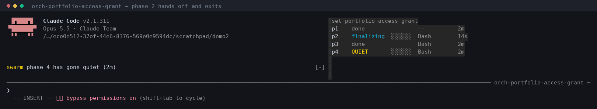

# claude-commands

Slash commands, subagents, skills, and a mod for [Claude Code](https://claude.ai/code). Almost
every file is a prompt, not a program — there is nothing to build or run. The one exception is
[`mods/swarm-deck`](mods/swarm-deck), which is JavaScript that runs inside Claude Code itself.

**The idea underneath most of it: [Sessions, not subagents](docs/session-swarm.md).** A Claude
Code session here starts other *full* Claude Code sessions, each in its own tmux window and git
worktree. They message each other by name, coordinate through a committed ledger, and keep going
after the session that started them closes. `/analyze` → orchestrator → one session per phase has
run 100 plan sets and 451 landed phases unattended. The doc covers why, what it costs, what had to
be built before it held, and how it compares with agent teams, Gas Town, claude-squad and others.

## Contents

- [Sessions, not subagents →](docs/session-swarm.md) — the tmux swarm: design, trade-offs, track record, prior art
- [Install](#install)
- [Commands](#commands)
  - [Session names](#session-names)
  - [`/analyze`](#analyze)
  - [`/implement`](#implement)
  - [Unattended: `/analyze` orchestrates by default](#unattended-analyze-orchestrates-by-default)
  - [`/analyze-orchestrator`](#analyze-orchestrator)
  - [`/do`](#do)
- [Agents](#agents)
- [Skills](#skills)
  - [`task`](#task)
  - [`swarm`](#swarm)
  - [`create-task`](#create-task)
- [Borrowed from pstack](#borrowed-from-pstack)
  - [`engineering-principles`](#engineering-principles)
  - [`create-verification-skill`](#create-verification-skill)
- [Borrowed from Kiro: EARS acceptance criteria](#borrowed-from-kiro-ears-acceptance-criteria)
- [Workflows](#workflows)
  - [Bug → fix](#bug--fix)
  - [A plan set as a swarm](#a-plan-set-as-a-swarm)
  - [Large refactor or purge](#large-refactor-or-purge)
  - [Task tracking](#task-tracking)
  - [Cards and `/analyze` in one prompt](#cards-and-analyze-in-one-prompt)
- [`/implement` vs `/do` vs `/analyze-orchestrator`](#implement-vs-do-vs-analyze-orchestrator)
- [Layout](#layout)
- [Mods](#mods)
  - [`mods/swarm-deck`](#modsswarm-deck)
- [Contributing](#contributing)
- [License](#license)
- [Other tools →](docs/other-tools.md) — `/dbg`, `/token-maxxing`, `/up-version` and the standalone skills

## Install

```bash
git clone https://github.com/miftahulmahfuzh/claude-commands.git
cd claude-commands
./sync.sh
```

`sync.sh` copies `commands/*` → `~/.claude/commands/`, `agents/*` → `~/.claude/agents/`,
`skills/*` → `~/.claude/skills/`. Re-run it after any edit. The mod is **not** synced — see
[Mods](#mods) for why it loads from the repo instead.

**Legacy installs:** earlier versions were cloned directly into `~/.claude/commands/`, leaving
repo files that show up as bogus commands, plus `.subagents/` and `.workflows/` that Claude Code
loads as skills shadowing the real agents. `./remove_non_commands.sh` clears them; it only ever
deletes inside `~/.claude/commands/` and is safe to re-run.

---

## Commands

| Command | What it does |
|---|---|
| `/analyze` | Traces the code, writes the implementation plan — the only command that plans — then starts it |
| `/implement` | Executes a plan: creates the tasks, applies the code |
| `/analyze-orchestrator` | Runs a whole plan set as a swarm — a session per phase, resumable on any machine |
| `/do` | Executes one existing task by TaskID |
| `/analyze-package` | Generates a package's code-quality analysis |
| `/update-readme` | Creates or refreshes `package_readme.md` |
| `/update-todos` | Creates or refreshes `todos.md` |
| `/reorganize-todos` | Re-sorts todos by priority |
| `/postmortem` | Documents what went wrong in a session |

`/dbg`, `/token-maxxing` and `/up-version` stand outside this pipeline — see
[Other tools](docs/other-tools.md).

### Session names

Five terminals open on one repo all carry the same derived name — `agentic-8f`, `agentic-d4` —
which says which repo and not which piece of work. So the long-running commands rename the
session after their errand, as soon as they know it:

| Command | Name | Renamed at |
|---|---|---|
| `/task <n>` | `task-<n>` | claiming the card |
| `/analyze` | `analyze-<slug>` | step 4, with the worktree — and also without one |
| `/implement` | `impl-<slug>-p<N>` | step 2, phase included when `--phase` gave one; never widening a launch name |
| `/do <TaskID>` | `do-<TaskID>` | immediately; the id is the argument |
| `/analyze-orchestrator` | `orch-<slug>` | step 3, once the ledger is verified |

A rename never *widens*: `--no-widen` refuses one whose target is the name already held minus a
suffix, so a phase session launched as `impl-<slug>-p2` cannot rename itself down to
`impl-<slug>` and share that address with every other phase of the set.

All of them (and `/token-maxxing`) call `skills/task/session.py`, which sends the same `/rename`
control message over the session's own messaging socket — so the tab title, the `/resume` row and the name peers address
change together, instead of a file write the running process would ignore. It renames the **tmux
window** too, which under tmux is the only one of those actually on screen, since the status line
covers the terminal's tab title. It can never fail the caller: no socket, no tmux, or a
non-interactive session all produce `renamed: false` with a reason and exit 0.

### `/analyze`

Traces dataflow, documents structure, and **writes the implementation plan**. It is the only
command that plans; `/implement` and `/do` execute what it wrote. It never edits source code.

```bash
/analyze [target] [bug|feature|update|refactor] [--phases N] [--no-worktree]
         [--no-orchestrate] [--permission-mode MODE]
<free-form description>
```

Everything is optional; `/analyze` followed by prose works, and the target and type are inferred.
**It orchestrates by default** — when the plan is done it launches the orchestrator itself, so the
work starts without anyone pasting a command. `--no-orchestrate` stops after planning; see
[Unattended](#unattended-analyze-orchestrates-by-default).

Every run produces the same three things, in a worktree it cuts off `origin/main`:

| Artifact | What it is |
|---|---|
| `.workflows/analyze/<session-id>_code_analyzer.md` | the analysis — descriptive, what exists today |
| `.workflows/plan/<SLUG>_PLAN.md` | the plan index — phases, order, invariants, open questions |
| `.workflows/plan/<slug>/phase-{N}.md` | one implementation plan per phase, with complete code |

The only thing that varies is **N**, the number of phases (1–20). A bug fix gets N=1 — same
artifacts, one phase, not a lesser mode. N grows when the change spans 3+ packages, has a
required order, or must stay shippable at every step.

The user's asks are numbered `R1…Rn` and every phase declares which `R` it serves, so the plan
index says what the user wanted *and* how it decomposes. That mapping is what reconciles "make me
2 cards" with a 4-phase plan set — see `create-task`.

Beneath the `R` table, each ask is broken into **acceptance criteria in EARS form**, borrowed
from [Kiro specs](https://kiro.dev/docs/specs/feature-specs/requirements-first/): `R2.1` reads "WHEN <trigger> THE SYSTEM
SHALL <behavior>", or one of the other patterns (ubiquitous "THE SYSTEM SHALL", `WHILE <state>`,
`IF <unwanted condition> THEN`, `WHERE <feature>`). The verbatim ask stays beside them, because
the rationale is the spec. Every Proof journey in a phase plan names the criteria it traces;
`plan-reconciler` checks that every criterion has an owning phase and a journey, mechanically,
with `skills/swarm/ears_trace.py`; and the verifier returns a verdict per criterion. A plan set
written before criteria existed has none and runs exactly as before.

For N > 1 the phases are planned **in parallel** — one `phase-planner` each — and then
reconciled. Parallel planners can't see each other's plans, so each declares an **Interface
Contract** (what it deletes, renames, creates, and requires from earlier phases), and
`plan-reconciler` uses those to find deleted-then-used symbols, unmet assumptions, duplicate
work, file collisions, and gaps — then **edits the plan files** to fix them. A behavioral fork
between two plans is **decided** on the highest rung that speaks (invariant → exit criteria → code
blocks → the index's Why and Requirements → the user's raw input) and recorded under
**Decisions** with that rung, so the executors inherit the answer instead of asking for it.
**Open Questions** is left for the residue: a requirement or acceptance criterion no phase can
own, or a fork where every branch is irreversible. A criterion that has an owner but no Proof
journey is fixed by editing that phase's plan, never parked.

Every phase must build and pass tests on its own, so the branch is reviewable at any point.

```bash
# terse, classic form
/analyze aggregation_mode bug

Context: Citations missing in aggregated responses
Error: <logs>

Files:
@tools/toolcore/caller.go

# free-form — no target, no type
/analyze
i want to purge direct tool streaming capability from this codebase. reasons:
1. tencent rag had a streaming api, so i built an abstraction for future streaming tools
2. two years later there are still no other streaming tools
3. cs_manager's three personas can't pass a tool's stream straight through anyway
YAGNI. let the feature go.
```

The rationale is copied into the plan index verbatim — on a purge, the reasons are the spec for
what may be deleted and what may not.

### `/implement`

```bash
/implement -f .workflows/plan/<SLUG>_PLAN.md [--phase N] [--all] [-note <note>]
```

Executes the plan. It creates one task per phase across the packages the plan names, copies each
phase plan to `{pkg}/.workflows/plan/{TaskID}.md` **unchanged**, applies one phase, runs the
plan's verification commands, and hands off to `completion-handler`.

It stops after one phase by default so the next starts in a fresh context; `--all` continues in
one session. Phases stay blocked until their dependencies complete.

**It writes no plans.** Handed a `*_code_analyzer.md` it refuses and names `/analyze` — an
analysis describes the code, and filling the gap here is what this command deliberately doesn't
do. Same rule when the code has drifted from what a plan quotes: small drift is followed and
noted, large drift stops with `Re-run /analyze`.

### Unattended: `/analyze` orchestrates by default

```bash
/analyze
<what you want changed, and why>
```

That is the whole unattended workflow. The plan lands at 22:30 and the orchestrator starts at
22:30, in its own tmux window, with nothing pasted. `/analyze` launches it as its last act and
does not wait for it. The long form means the same thing:

```bash
/analyze --orchestrate --permission-mode bypassPermissions   # the default, spelled out
/analyze --no-orchestrate                                     # plan only, print the command
/analyze --permission-mode acceptEdits                        # narrow what the children may do
```

It refuses to launch — and says so instead — when **Open Questions is non-empty** (an unattended
swarm is the worst place for an unresolved contradiction, since N sessions would each answer it
differently) or when a **phase plan file is missing**. Since reconciliation now decides ordinary
forks rather than parking them, the first refusal is rare by construction: what survives to Open
Questions is a fork where every branch is irreversible, which is worth a night of nothing.

The default mode is `bypassPermissions`, which gives the orchestrator and its phase sessions a
mode the `/analyze` session may not itself hold. That is a deliberate standing decision rather
than an inference, and what makes it reasonable is the isolation: `/analyze` cuts a worktree and
a branch, so an unattended run's blast radius is a feature branch, not your working tree.

**No session in that chain asks you anything.** `/analyze`, `/analyze-orchestrator`, `/implement`
and `/do` each carry the same precedence ladder — **stated invariant → exit criteria → the plan's
code blocks → the index's Why and Requirements → the task text or your raw input → surrounding
convention** — and decide on the first rung that speaks, then write down which rung it was. The
arithmetic is one-sided: a wrong call costs one follow-up commit, while a question asked into an
empty room costs every hour until you wake up. MEASURED: one phase session held an
`AskUserQuestion` for eight hours over a contradiction its plan's own invariant settled, and the
two phases depending on it built nothing all night.

Every decision surfaces in a `Decided without asking` block in the terminal, in `todos.md`, and in
the commit body — so the morning's job is reviewing calls that were made, not answering questions
that blocked. Stopping is allowed; blocking is not.

An unattended run stops at the merge. Every phase landing on the branch overnight is the value;
merging the set is a thirty-second decision in the morning and not worth doing unsupervised.

### `/analyze-orchestrator`

```bash
/analyze-orchestrator -f .workflows/plan/<SLUG>_PLAN.md   # drive a fresh plan set
/analyze-orchestrator --resume <slug>        # pick it up again — any machine, any time
/analyze-orchestrator --status <slug>        # report, change nothing
```

`/implement` walks a plan set one phase per session. This runs the same set as a **swarm**: it
reads the index's **Depends on** column as a DAG, opens a session per phase for every phase in a
wave, watches them, verifies what they claim, and lands the result. Phases that share no
dependency edge run at the same time, in their own tmux windows.

It **writes no plans** either — same invariant as `/implement` and `/do`.

Three rules it will not bend:

1. **The plan set is committed and pushed before a single phase is spawned.** A set that lives
   only in a worktree dies with that worktree — which has happened here, and cost a
   reconciliation nobody could read back.
2. **The ledger is pushed after every phase, not at the end.** Resume recovers only what reached
   the remote, so this bounds the loss to one phase.
3. **A finished phase's window is closed, permanently.** claude idles rather than exiting when a
   phase is done, so nothing closes those windows unless the orchestrator does — and two waves
   in, the running sessions are off the end of a tab bar full of finished ones. The pane's
   scrollback is captured to a file first, and any phase can be reopened with a fresh session,
   so this loses nothing.

**Resume is a re-derivation, not a replay.** The committed ledger is a hint; the real status
comes from what cannot lie — whether the commit is an ancestor of the branch, and what
`todos.md` says about the TaskID. One asymmetry is deliberate: a `done` phase is *never*
downgraded on missing evidence, because "not on the branch" and "not fetched here" look identical
to git, and confusing them re-runs work that already shipped.

What it cannot recover, stated plainly: **uncommitted or unpushed work on the other machine.** A
phase half-applied when the lid closed restarts from its plan — survivable exactly because
`/analyze` builds phases that stand alone.

### `/do`

```bash
/do P2-CL-A001                                    # EASY — brief from the task text
/do P1-DB-A236 --note="also handle the bulk path"
/do P1-TC-A002                                    # a plan-set phase — executes its plan directly
/do P1-TP-A023                                    # HARD, no plan — runs /analyze itself
/do P1-TP-A023 --no-escalate                      # ...or just prints that command and stops
```

Subagents around one main-context step, and **the route depends on whether the task has a plan**.
`task-locator` finds the TaskID either way. Then:

- **Adopted path** — the task carries a `**Plan**:` line and the file is there, which is every
  phase of an `/analyze` plan set. `context-loader` and `plan-generator` are both skipped and
  **the main context reads that plan and applies it.** The plan's code blocks are complete by
  construction, and a brief has nowhere to put them, so passing a cooked plan through
  `plan-generator` would compress them into prose the executor then works from instead of the
  code. `/implement` has always read the phase plan directly; this is the same behavior reached
  from a TaskID.
- **Brief path** — no plan file, EASY or NORMAL. `context-loader` condenses the docs,
  `plan-generator` emits a routing brief, and **the main context writes the code**.
- **Escalation** — no plan file, HARD. `/do` **runs `/analyze` itself** and stops its own
  pipeline; no subagent is dispatched to reach that conclusion, because the locator's
  `difficulty` and `plan_file` already state it. `/analyze` is the full unattended workflow —
  worktree, plan set, and the orchestrated run, which is its default — so the escalation
  continues the work rather than handing a command back to a human. That is the case where a
  real plan matters, and printing its name and stopping was one paste away from the plan
  nobody asked for again: `--no-escalate` is there for when the paste is what you want. A
  `**Difficulty**:` line that says HARD anywhere — `NORMAL to fix, HARD to decide` — escalates,
  and the banner quotes the line verbatim so the reading is visible.

Either way `completion-handler` updates `todos.md` before chaining `readme-updater` and `pusher`.

The main context never reads `todos.md`, `package_readme.md` or `analysis_report.md`, and never
runs git. It reads exactly one plan file — the adopted one — and no other `.workflows` file;
that isolation is the point of the design.

---

## Agents

Dispatched by `subagent_type`. `haiku` for mechanical work, `opus` where judgment matters.

| Agent | Model | Purpose |
|---|---|---|
| `task-locator` | haiku | find a TaskID across every `todos.md`, return metadata |
| `context-loader` | opus | read package docs, return a condensed packet (brief path only) |
| `plan-generator` | opus | routing brief for a task with no plan; refuses one that has a plan |
| `phase-planner` | opus | plan one phase, in parallel with the others |
| `plan-reconciler` | opus | resolve cross-phase conflicts by editing the plans |
| `completion-handler` | opus | update `todos.md`, then chain readme-updater and pusher |
| `readme-updater` | opus | update the most-impacted `package_readme.md`, creating it if absent |
| `pusher` | haiku | stage, commit with a conventional message, push |
| `integrator` | opus | merge one wave's branches in dependency order, run the full suite, fast-forward the set branch |
| `verifier` | sonnet | prove landed phases work by driving the real app through the repo's `verify-*` skill, one verdict per acceptance criterion (per phase on a legacy set); never edits code |

`pusher` owns **all** git side effects for command-driven work. Invoke it directly by saying
`run pusher`.

---

## Skills

Skills live in `skills/<name>/SKILL.md` and are auto-discovered from their `description`
triggers. Most fire on their own; the task ones are also invocable by name. Only the skills
the pipeline uses are described here — readers, writers and one-off utilities (Confluence, Jira,
Google Docs, PDF and CV editing, Vercel cleanup, …) are in [Other tools](docs/other-tools.md#skills).

### `task`
Task cards on GitHub Projects (personal repos) or GitLab Issues (work repos), chosen from the
`origin` remote. `/task 14` claims the card by moving it to In Progress, reads every comment,
designs the change without asking, writes the plan, and links it onto the card.

**It runs unattended.** No approval step and no questions — a question at 1am costs the night
and gets a reflexive `y` at 9. It decides, records the losing approaches in the plan, and keeps
going. Five enumerated conditions end the session cleanly with the card in a truthful stage and
the reason commented on it; everything else gets decided.

|  | Personal repos | Work repos |
|---|---|---|
| Cards | GitHub Issues + a `Tasks` Projects board | GitLab Issues |
| Stage | the board's Status field | `status::*` labels |
| Development | worktree off `origin/main`, ending in a PR the session merges | mints a TaskID, hands off to `/do` |
| Completed | linked PR merged; the issue is closed either way | issue closed |
| Phases of a plan set | sub-issues; the parent owns the branch and the PR | flat TaskIDs in `todos.md` |

On GitHub the gate is the repo's **own** `.github/workflows` — every `run:` step of every
push/PR job, in order (on one real repo, 14 commands including seven bespoke guards a hardcoded
`npm test` would have waved through). No CI at all means `land` derives a gate from
`package.json` / `Makefile` / `pytest` / `cargo` / `go test` and names what passed on the card.

A card carrying `/analyze` phases is a **parent with one sub-issue per phase**, and the rule there
is forced rather than chosen: **the parent owns the worktree, the branch and the pull request; a
phase owns a commit.** Phase 2's plan quotes the tree as it looks after phase 1, which is not on
`origin/main` yet, so a phase that branched off the base would implement against code that does
not exist. `/task 13` addresses a phase directly (sub-issues are real issues), `resolve` answers
`parent` / `position` / `blockedBy` / `ownsPullRequest` in one call, and
`finish 13 --child-of 12 --commit <sha>` completes a phase on four checks instead of a merge.
Running `/task` on the *parent* drives every phase in order and opens one PR — `/implement --all`
reached from the board.

Parallel sessions off the same `origin/main` will conflict; `land` exits 2 with the conflicting
files and the other card's number. The session resolves it by a stated rule and re-runs the
gate — but a resolution that removes the other card's behavior is not a resolution, and
`--abort-conflict` comments on both cards instead.

Three things measured rather than assumed: GitLab CE doesn't enforce scoped-label exclusivity,
so transitions rewrite the whole label set and verify; in `todos.md` the checkbox is the stage
only under `## Active Tasks`; and package codes aren't unique, so uniqueness is checked on the
whole TaskID. **Completed means closed on both backends** — on GitLab that took a shared repo
showing 55 open issues, 44 of them finished (now 11); on GitHub it took a parent card reading
`0 of 2` while both its phases were green, because sub-issue progress counts *closed* children
and only the parent's PR carried a closing keyword.

Claiming a card also renames the terminal to `task-<n>`: five sessions in one repo otherwise
all carry the same derived name, and the card number is the only thing that separates them.
It goes over the session's own messaging socket, the way `/rename` does, so the tab title,
the `/resume` row and the peer address change together — plus the tmux window, which under
tmux is the only one of those actually on screen. It can never fail the loop.

**Layout:** `taskcore.py` (shared codec and stages) · `task_gh.py` (gh CLI) · `task_gl.py`
(GitLab REST over urllib) · `todos.py` (the TaskID corpus) · `session.py` (the rename).
Every module has an offline `selftest`.

**Setup:** GitHub needs `gh auth refresh -s project,read:project` and the **Linked pull
requests** field as a board column. GitLab needs a PAT with `api` scope in
`~/.config/task-skill/gitlab`, then `labels --ensure` and `board --ensure` per project.
`doctor` reports what's missing on either backend.

### `swarm`

The mechanics behind `/analyze-orchestrator`: wave scheduling from a plan set's `Depends on`
column, spawning a named session per phase, and the two-half ledger that makes a set resumable on
another machine.

It also keeps tmux readable. `swarm.py reap` captures a finished phase's whole scrollback to
`.workflows/orchestration/<slug>/logs/phase-N.log` and then closes its window for good — refusing
on its own to touch a phase still working, a `done` whose commit is not yet on the branch, a
window id that now belongs to somebody else, or the caller's own window. A failed phase keeps its
window until asked for by name, because that output is what someone is about to read.

Sessions address each other by name — `ListAgents` lists the peers, `SendMessage` writes to one —
so a phase session reports to its coordinator when it lands, and warns any peer whose working
directory is inside a worktree it is about to delete. Messaging is the local nervous system and
dies with the machine; the committed ledger is the skeleton and does not. `swarm.py verify`
re-derives every phase's real status from the branch and `todos.md` rather than trusting what the
ledger claims, and never downgrades a landed phase on absent evidence — on a clone that has not
fetched yet, that mistake would re-run work that already shipped.

```bash
python3 ~/.claude/skills/swarm/swarm.py track            # once per repo
python3 ~/.claude/skills/swarm/swarm.py waves  --slug <slug>
python3 ~/.claude/skills/swarm/swarm.py verify --slug <slug> --apply
python3 ~/.claude/skills/swarm/swarm.py reap   --slug <slug>       # close finished windows
python3 ~/.claude/skills/swarm/swarm.py selftest
python3 ~/.claude/skills/swarm/plan_graph.py <PLAN.md>   # the write-set gate, before spawning
python3 ~/.claude/skills/swarm/ears_trace.py <PLAN.md>   # every EARS criterion owned and traced
```

Which of a repo's paths are generated or binary — and which suite the `integrator` runs after
merging a wave — is per-repo, not baked into the tool: an optional `<repo>/.workflows/swarm.json`
declares them, on top of what the repo's `.gitattributes` already says and a universal suffix
baseline. See `skills/swarm/SKILL.md`, "Per-repo artifact classes".

### `create-task`
The front door to the same board. `/create-task "…"` opens the issue, adds it to the board, and
sets the Open stage — three operations, because `gh issue create` alone produces an issue no
column shows. It never asks a question: the project comes from the reference, the repo, or the
files being edited, and otherwise the card is captured as a GitHub draft item. Then it stops —
working the card is `/task <number>`.

**When `/analyze` ran in the same prompt, `/analyze` goes first and the cards come from its plan
index.** The two counts are different altitudes, not rivals: the user names *deliverables*
(`R1…Rn`), `/analyze` decides *phases*. So one parent card per `R` with its phases as GitHub
**sub-issues**, in phase order — or a single parent for the whole set when a phase straddles two
`R`s and can be attached to neither. The parent carries the branch, the base sha and the plan
index; each phase carries its own plan path and `finish --child-of`. GitHub only: GitLab has no
sub-issues below Premium, and there the phases are already flat TaskIDs that `/do` walks.

---

## Borrowed from pstack

Two pieces of this pipeline are adapted from Lauren Tan's
[pstack](https://github.com/cursor/plugins/blob/main/pstack), Cursor's plugin for planning and
proving agent work. We took the ideas and reshaped them to fit `/analyze` and the swarm.

### `engineering-principles`

Adapted from pstack's
[engineering principles](https://github.com/cursor/plugins/blob/main/pstack/docs/guide/08-principles.md).
It holds ten principles grouped as scope, correctness, verification and meta: *subtract before
you add*, *build the lever*, *make illegal states unrepresentable*, *fix root causes*, *prove it
works*, and five more. `phase-planner` and `plan-generator` read them **once, while planning**.
Wherever a principle changes the plan, the change goes under the plan's **Principles applied**
heading as `<principle>: <the decision it changed>`. A principle with no decision behind it is
left out. The sessions that implement the plan never load the file. They inherit the decisions,
so the principles cost one read per plan, not one per agent.

### `create-verification-skill`

Adapted from pstack's
[`create-verification-skill`](https://github.com/cursor/plugins/blob/main/pstack/skills/create-verification-skill/SKILL.md).
`/create-verification-skill` writes a repo-local `verify-<app>` skill. That skill launches a
throwaway instance of the app, drives it the way a user would, and saves evidence, along with a
feature map of what proves each feature. Our version starts by copying the nearest **sibling**,
a `verify-*` skill already working in another repo. It keeps the detail for each repo shape
(browser UI, auth and seeding, third-party stand-ins, no-server repos) in `references/`, built up
over eleven real runs.

The generated skill is what gives principle 7 (*prove it works*) teeth. A phase plan's **Proof**
section names its journeys, each labelled `J{k}` and tracing the acceptance criteria
(`R{n}.{m}`) it proves. The implementer runs them. Then the `verifier` agent, which neither
wrote the code nor read the implementer's reasoning, runs them again and records a verdict per
criterion: once per wave under the orchestrator, or once per set under `/implement` and `/do`.
Small sets skip the separate verifier and land on the implementers' own evidence.

---

## Borrowed from Kiro: EARS acceptance criteria

From [Kiro specs](https://kiro.dev/docs/specs/feature-specs/requirements-first/). `/analyze` keeps each ask word for word
in the `R` table and splits it into numbered **EARS** criteria beneath it (`R2.1`: "WHEN
<trigger> THE SYSTEM SHALL <behavior>", or one of five other patterns). Every Proof journey in a
phase plan names the criteria it proves. `plan-reconciler` and `/analyze` Step 9 then check, with
`skills/swarm/ears_trace.py` rather than by reading prose, that every criterion has an owning
phase and a journey. The `verifier` returns a verdict per criterion instead of per phase, so a
failure names the promise that broke. Plan sets written before this have no criteria table and
run as before. Full details: [EARS acceptance criteria →](docs/ears/README.md)

---

## Workflows

### Bug → fix

```bash
# Session 1 — investigate and plan
/analyze aggregation_mode bug
Context: Citations missing in aggregated responses
Files:
@tools/toolcore/caller.go
# → worktree feature/fix-citation-aggregation, the analysis doc,
#   .workflows/plan/FIX_CITATION_AGGREGATION_PLAN.md, and one phase plan

# Session 2 — execute
cd ~/.worktrees/<repo>/fix-citation-aggregation
/implement -f .workflows/plan/FIX_CITATION_AGGREGATION_PLAN.md
```

Session 1's exploration tokens are thrown away; session 2 pays only for implementation, since
the plan already says exactly what to change. Pass `--no-worktree` to plan against the branch
you're on.

### A plan set as a swarm

```bash
# Session 1 — plan, as usual
/analyze <what you want changed, and why>
# → 4 phases; the index says 1 and 3 depend on nothing, 2 needs 1, 4 needs 2 and 3

# Same session, or any other — drive the whole set
/analyze-orchestrator -f <SLUG>_PLAN.md
# → wave 0: phases 1 and 3 spawn together, each in its own tmux window
#   wave 1: phase 2, once 1 has landed
#   wave 2: phase 4
```

Or just don't type the second command at all — orchestration is the default:

```bash
/analyze
<what you want changed, and why>
# 22:30  plan lands, orchestrator launches itself in its own window
# 22:31  wave 0 spawns
# 07:00  every phase on the branch, waiting on your merge
```

With the [`swarm-deck`](#modsswarm-deck) mod loaded, the coordinator and every child get their
phase plans' absolute paths attached to the prompt, resolved by `plan_graph.py`, so nobody
goes looking for a plan file.

Each child is launched with `claude -n impl-<slug>-p<N>`, so its peer address exists before the
process boots and the coordinator never races the child's own rename. When a phase lands it
writes the ledger and messages the coordinator; the coordinator verifies the commit is really on
the branch before believing it, then pushes the ledger and recomputes the wave.

Close the laptop mid-run and pick it up on another one:

```bash
git pull
/analyze-orchestrator --resume <slug>
```

Two details make that work, and both are worth knowing before the first run. **Spawn children on
the coordinator's own permission mode** (`--permission-mode`) — a child on a different mode has
its reports held for you to approve, and a stalled swarm looks exactly like a slow one. And the
**folder-trust prompt** would otherwise block every spawned session before it boots, since each
worktree is a path Claude Code has not seen; `swarm.py spawn` propagates the repo's existing
trust to its worktree, and refuses rather than inventing trust if the repo itself is untrusted.

### Large refactor or purge

```bash
# Session 1 — planning
/analyze
<what you want changed, and why it's worth doing>
# → worktree feature/<slug>, an analysis doc, .workflows/plan/PURGE_..._PLAN.md, and
#   .workflows/plan/<slug>/phase-N.md for each phase, reconciled against each other

# Session 2 — phase 1, which also creates one task per phase
cd ~/.worktrees/<repo>/<slug>
/implement -f .workflows/plan/PURGE_..._PLAN.md --phase 1

# Session 3..N — one phase each
cd ~/.worktrees/<repo>/<slug>
/do P1-TC-A002
```

**You don't have to remember any of those commands.** Each session ends by printing the next
one, ready to paste: `/analyze` hands you the `--phase 1` line, and every `/do` or `/implement`
that finishes a phase hands you the following phase's `/do`. The last phase hands you the merge
instead. The command is always alone on its own line so it can be selected and pasted — nothing
follows it there, because a trailing `#` on a slash-command line is read as arguments.

Read the plan index's **Decisions** before starting — those are the forks reconciliation settled
for you, each with the rung that settled it, and they are the morning's review queue. **Open
Questions** holds only what could not be decided at all. Merge the branch once as a whole.

### Task tracking

An idea arrives away from the keyboard and goes into a notes app Claude Code can't see. `/task`
makes the browser the front door: file the card anywhere, then `/task 14` picks it up. Going the
other way, [`/sync-todos-into-gitlab-board`](docs/other-tools.md#sync-todos-into-gitlab-board) populates
the board from work already tracked.

A card sits in In Progress only while genuinely being worked, and reaches Completed only when
the repo's gate passed and the host reports the PR merged — a mechanical bar, which is what
lets the loop close with nobody watching.

### Cards and `/analyze` in one prompt

The case this shape was built for, from `JMTarot`:

```bash
/create-task 2 cards and /analyze
1. pull data from neon prod. there are 3 "Bacaan ini tidak selesai" — we should add a
   "Coba ulang" button so this empty reading can be refilled.
2. in history item list, make it so user can swipe left to show a trash icon. clicking
   it soft-deletes the reading. sometimes users asked embarrassing questions.
```

**What that produced before:** two cards (#11, #12) *and* a four-phase plan set with 20
inconsistencies reconciled — with no relationship between them. Both halves did exactly what
they promise; they were produced blind, because `create-task` fires in two seconds and never
asks, so it committed the board to a shape before the only thing that had read the code existed.

**What it produces now.** `/analyze` runs first and numbers the asks `R1` (retry) and `R2`
(delete); each of the four phases declares the one `R` it serves, so the mapping is a table
lookup and neither count is overridden — the user's 2 is the parent count, `/analyze`'s 4 is the
sub-issue count:

```
#11  Coba ulang: refill a reading that never finished          [R1]  Open
 ├─ #15  Phase 3 — the predicate, the writer, the endpoint
 └─ #16  Phase 4 — the Coba ulang control, copy, docs
#12  Swipe left to delete a reading from history (soft delete) [R2]  Open
 ├─ #13  Phase 1 — schema, read filters, delete route
 └─ #14  Phase 2 — the swipe gesture and the row
```

Each parent body carries the plan index, the branch and base sha, and the worktree path marked
as machine-local. Each phase body carries its own plan path *with the branch* — `/analyze` writes
plans inside the worktree, so the path is a dead link on `main` until the PR merges.

Then the phases are worked, in one worktree, by whichever session picks a card up:

```bash
/task 12            # the parent: drives phases 1 and 2 in order, opens one PR
/task 15            # one phase: works in #11's worktree, completes on its commit
```

```bash
python3 ~/.claude/skills/task/task_gh.py finish 13 --child-of 12 --commit <sha>
```

Had one phase served *both* asks — a migration both features need — it could be attached to
neither, and the answer is one parent for the whole set with the asks as bullets. That coupling
is a fact about the work, not a labelling problem.

**The order across two parents comes from the plan index, not the board.** `blockedBy` only sees
siblings, so it says phase 4 waits on phase 3; it cannot know that phase 3 waits on phase 1 under
a different card. The plan index's **Depends on** column is the authority there — read it before
picking up a phase whose parent is not the first one.

---

## `/implement` vs `/do` vs `/analyze-orchestrator`

None of the three writes plans. `/analyze` does, and all of these execute what it wrote.

| | `/implement` | `/do` | `/analyze-orchestrator` |
|---|---|---|---|
| Input | `<SLUG>_PLAN.md` | TaskID from `todos.md` | `<SLUG>_PLAN.md`, or a slug to resume |
| Sessions | one, one phase | one, one task | one per phase, concurrent by DAG |
| Creates the tasks | yes — one per phase | no, it already exists | delegates to the phase sessions |
| Where the plan comes from | the plan set, copied unchanged | the task's plan file, or a brief from its text | the plan set, committed first |
| Survives the machine | no | no | yes — resumable from the remote |
| Use when | starting the work `/analyze` planned | picking up a task that's already tracked | you want the set to run without you |

`/do` is also the way to run phase 2 onward of a plan set, one per session — the hand-driven
version of what the orchestrator does for you.

---

## Layout

```
claude-commands/
├── commands/                 # slash commands
│   ├── analyze.md            # archaeology + the implementation plan
│   ├── analyze-orchestrator.md  # run a plan set as a swarm
│   ├── analyze-package.md    # package quality analysis
│   ├── do.md                 # execute one task by TaskID
│   ├── implement.md          # plan → tasks → code (no planning of its own)
│   ├── postmortem.md, reorganize-todos.md, update-readme.md, update-todos.md
│   └── …                     # dbg, token-maxxing, up-version — see docs/other-tools.md
├── agents/                   # subagents, dispatched by subagent_type
│   ├── task-locator.md       ├── phase-planner.md
│   ├── context-loader.md     ├── plan-reconciler.md
│   ├── plan-generator.md     ├── readme-updater.md
│   ├── completion-handler.md ├── pusher.md
│   ├── integrator.md         └── verifier.md
├── skills/                   # each a directory with SKILL.md + assets
│   ├── create-task/
│   ├── task/                 # + DESIGN.md, taskcore/task_gh/task_gl/todos/session.py
│   ├── swarm/                # + swarm.py, plan_graph.py, ears_trace.py, tests/ — the orchestrator's mechanics
│   ├── engineering-principles/     # from pstack — read by the planners
│   ├── create-verification-skill/  # from pstack — + references/
│   └── …                     # the standalone skills — see docs/other-tools.md
├── mods/swarm-deck/          # the /fleet deck mod — loaded from the repo, not synced
├── docs/                     # session-swarm.md, other-tools.md, architecture-notes.md, ears/, design notes
├── cmd/dlv/                  # Delve helpers for /dbg — copy into your Go project
├── sync.sh
├── remove_non_commands.sh
└── README.md
```

A project using these commands ends up with:

```
your-project/
├── chatbot/bowl/.workflows/
│   ├── todos.md              # tasks, with TaskIDs
│   ├── package_readme.md     # technical docs
│   ├── analysis_report.md    # quality analysis
│   ├── plan/{TaskID}.md
│   └── postmortem/{TaskID}.md
└── .workflows/                            # repo root — /analyze writes nothing outside it
    ├── analyze/20250108-164512-A3F7_code_analyzer.md
    ├── plan/PURGE_..._PLAN.md             # the plan index
    ├── plan/<slug>/phase-N.md             # one per phase
    └── swarm.json                         # optional — this repo's generated and binary
                                           #   paths, and its full suite
```

TaskIDs are `P{0-3}-{SCOPE}-{ID}` (e.g. `P0-DB-A236`), unique across every `todos.md` in the
repo. Tasks are tagged EASY / NORMAL / HARD; EASY and NORMAL can run from the task description
alone, HARD requires a plan file — and `/do` gets one by running `/analyze` rather than by asking
for it.

---

## Mods

A [mod](https://code.claude.com/docs/en/plugins/mods/overview) is a plugin whose JavaScript hooks
run **inside** Claude Code's process. Unlike a settings hook, which is a shell command fired at a
lifecycle event, a mod's hook sits in front of the event as middleware and can observe it, rewrite
it, or **answer it outright** — so a tool call can be refused rather than merely logged. Mods need
Claude Code v2.1.287 or later.

### `mods/swarm-deck`

Makes the swarm's central invariant mechanical: **a phase session cannot block on a human.**

The orchestration docs already said it — *a phase that asks stalls its dependents, a coordinator
that asks stalls the whole set* — but they said it in a prompt, and a prompt is advice. MEASURED:
a phase-2 session held an `AskUserQuestion` for eight hours and stalled a six-phase set whose
answer was rung 1 of the precedence ladder.


`swarm-deck` hooks `tool.call` on `AskUserQuestion` in any session `swarm.py spawn` launched as a
phase, and refuses it — handing back the precedence ladder as the tool result so the phase decides
on the highest rung that settles it, and recording the decision for the coordinator's morning
review. Outside a swarm it is dormant and ordinary sessions are untouched.

It **fails closed**: a mod hook that throws is normally *skipped*, which here would let the dialog
render and stall the night, so the guard carries a `.catch` that re-issues the refusal. A test
forces the throw and asserts the refusal survives it.

Each row carries the phase's own status — `starting`, `working`, `finalizing` (its
`completion-handler` is running), `idle`, `done` — and the deck overrides it with the clock
where the clock knows better. A phase that stops reporting and never said goodbye reads
`QUIET` and lights the band; one that exited cleanly reads `done` and never does, however
long ago it finished. After a couple of hours an unexplained silence becomes `stale`:
history, not an emergency. Full table in the
[mod's README](mods/swarm-deck/README.md#what-each-status-means).

At or over 85% of the weekly quota (`CLAUDE_QUOTA_ECONOMY_PCT` to change it), the mod switches the
commands to economy mode: it adds a quota line to the context block and refuses to spawn the `verifier`
agent, so verification falls back to each phase's own single proof run. It fails open: no reading means
normal rules. The same mode sets every subagent to Sonnet unless it names haiku or sonnet, refuses a fork
of an Opus or Fable parent, and flags an Opus main session, since a mod cannot switch that model itself.
`swarm.py spawn` and `launch` read the mod's quota file and default to `--model sonnet` in the same state.



It also hands `/analyze-orchestrator` and `/implement` their plan files. A `prompt.submit` hook
runs `plan_graph.py --json` on the `-f` index (or the ledger's, for `--resume`) and attaches
every phase plan's absolute path and size to the prompt, or names the missing ones with the
path tried. Neither session lists a directory to find a plan. That is how a coordinator once
lost `phase-7.md` to `ls | head`. This hook fails open: if it breaks, the prompt goes in as
typed.

```bash
cd mods/swarm-deck
claude plugin validate .   # the events, calls and env reads the engine will actually see
claude plugin test         # offline: no session, no sign-in, no network
python3 tools/termshot.py shot <tmux-target> out.png   # regenerate the screenshots
```

It loads from the repo rather than through `sync.sh`:

```jsonc
// ~/.claude/settings.json
{ "env": { "CLAUDE_CODE_PLUGIN_DIRS": "/path/to/claude-commands/mods/swarm-deck" } }
```

Installed plugins are cached by version, and edits do not reach the installed copy without a
version bump — which is the same "deployed tree silently diverges from the repo" failure this
repo keeps a whole section of `CLAUDE.md` about. Pointing the loader at the repo leaves one
source of truth.

Full notes: [`mods/swarm-deck/README.md`](mods/swarm-deck/README.md), design in
[`docs/swarm-deck-mod-design.md`](docs/swarm-deck-mod-design.md).

---

## Contributing

Fork, branch, test against a real `.workflows/` directory, open a PR. Run `./sync.sh` to try a
change locally before committing it.

## License

[MIT](https://mit-license.org).
