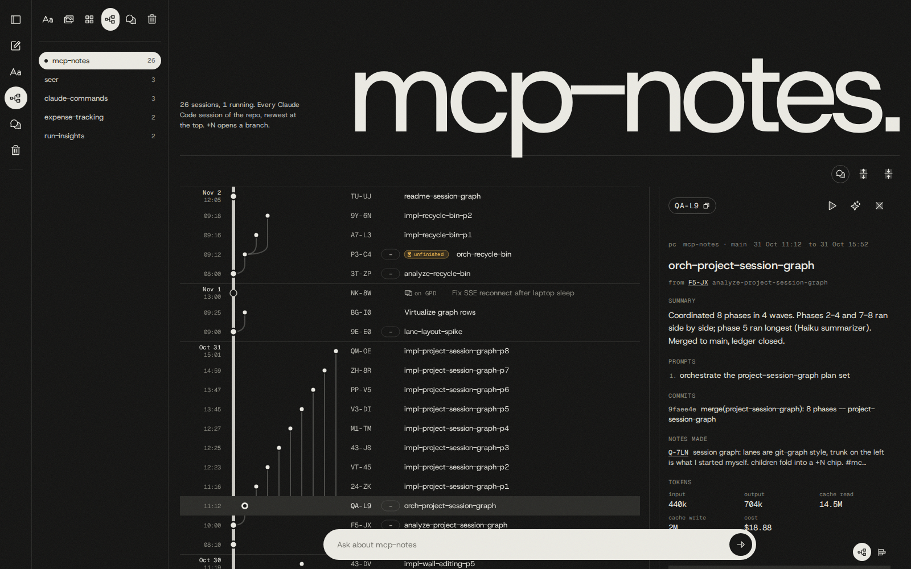
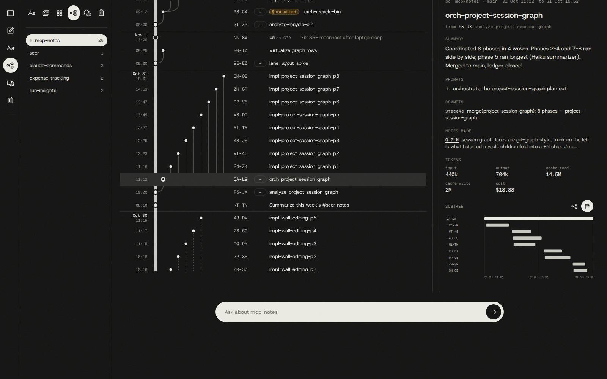

# Sessions, not subagents

Claude Code can already fan work out: a session dispatches subagents, they work in their own
context windows, and each hands a summary back. This repo goes one level up. **A Claude Code
session starts other full Claude Code sessions**, each in its own tmux window, each with its own
name, its own context window, its own git worktree, and a lifetime that does not depend on the
session that started it. They message each other by name. They write to the same ledger. When the
one that started them is closed, they keep working.

This page explains why, what it costs, what had to be built before it was reliable, and how it
compares with what other people are doing. It is written from running it every day on real work
since 4 September 2026, not from a design that has not met production yet.

- [The shape](#the-shape)
- [Track record](#track-record)
- [Subagents vs sessions](#subagents-vs-sessions)
- [Why a fresh context matters](#why-a-fresh-context-matters)
- [What it costs](#what-it-costs)
- [What had to be built before it held](#what-had-to-be-built-before-it-held)
- [Seeing the swarm: the session graph](#seeing-the-swarm-the-session-graph)
- [Which one to use](#which-one-to-use)
- [How others do it](#how-others-do-it)
- [Borrowed, and worth borrowing next](#borrowed-and-worth-borrowing-next)
- [References](#references)

---

## The shape

```
 you ──▶ discussion session          the only place a human types
           │  "/analyze <what and why>"
           ▼
         analyze-<slug>              reads the code, writes the plan set, cuts a worktree
           │  swarm.py launch          (planners + reconciler run here as subagents)
           ▼
         orch-<slug>                 reads the Depends-on DAG, spawns a wave, verifies, lands
           │  swarm.py spawn ×N
           ├──▶ impl-<slug>-p1 ─┐    wave 0: no dependencies, run side by side
           ├──▶ impl-<slug>-p3 ─┤
           │       integrator + verifier per wave
           ├──▶ impl-<slug>-p2 ─┤    wave 1: needs p1
           └──▶ impl-<slug>-p4 ─┘    wave 2: needs p2 and p3
                    │
                    ▼
            merged to main, migrations applied, branch and worktrees deleted
```

The manual step is the first one. After you type `/analyze`, nothing else needs a human: the
analyzer launches the orchestrator, the orchestrator launches the phases, and the orchestrator
merges the result. Sessions do still use subagents inside themselves (the parallel
`phase-planner`s, `integrator`, `verifier`, `pusher`). The rule is about *altitude*: a unit of work
big enough to need its own judgement gets its own session, and mechanical or bounded jobs stay
subagents.

There are three ways a session gets spawned in practice:

1. **Plan set → swarm.** `/analyze` → `/analyze-orchestrator` → one session per phase, scheduled
   by the plan's dependency DAG. [Details](../README.md#analyze-orchestrator).
2. **Exploration fan-out.** In [Seer](https://github.com/miftahulmahfuzh/seer), `/sera-the-explorer N`
   is a coordinator that keeps up to four `/explore-and-experiment-new-method` sessions running,
   each in its own worktree and tmux window. Each one pre-registers a trading idea, runs it,
   writes the analysis, and queues the next idea. Sera picks a diverse slate, keeps the shared lab
   database consistent, verifies each child's claims against the database and `git log`, refills
   a slot when one finishes, and writes the batch synthesis. Exploration has no DAG and no merge.
   It is a pool, not a pipeline, and the same `swarm.py launch` runs it.
3. **Ad hoc.** Any session can start another with `swarm.py launch --name <x> --prompt "…"`, for
   example a handover ("write what's left, open a fresh `/analyze` on it"), a side investigation
   that should not pollute the current context, or a long-running fix the current conversation
   should not wait on.

## Track record

Counted from the committed ledgers on 2026-11-11:

| | |
|---|---|
| Plan sets run as swarms | **100**, across 8 repos (Go backend at work, a trading lab, a notes app, a running coach, …) |
| Phases spawned as their own sessions | **491**, of which **451** are `done` |
| Methods in Seer's lab (most of them explored by Sera's children) | **571** |
| Longest unattended run without a human | overnight, analyze to merged `main` |

One real chain, from the work Go repo, over 9 and 10 November: a discussion session diagnosed a
bug ticket, an `/analyze` session planned the fix, its orchestrator landed three phases, a second
`/analyze` (spawned from the orchestrator because live measurements still showed a problem)
planned two more, then a seven-phase migration to a different backend service landed. Five
follow-up fixes went in after that. Each node was a separate session with a clean context. Asked
afterwards "summarize what we did about that ticket", the [session graph](#seeing-the-swarm-the-session-graph)
answered with every commit, phase and open item, by reading those sessions rather than a
conversation that had been compacted five times.

## Subagents vs sessions

| | Subagent (Agent tool) | Spawned session (`swarm.py spawn` / `launch`) |
|---|---|---|
| Context | its own window, discarded on return | its own window, kept on disk; resumable with `claude --resume` |
| Lifetime | bound to the parent's turn; dies with the parent | independent; survives the parent closing, crashing, or compacting |
| Result path | a summary returned *into the parent's context* | artifacts: commits, the ledger, plan files, `todos.md`, messages |
| Parent's context cost | every result lands in the parent | a one-line `DONE` message; the parent reads git, not prose |
| Talking back | none mid-flight; one final return | peer messages by name, both ways, any time |
| A human can step in | no, it is invisible until it returns | yes: switch to its tmux window and type |
| Nesting | up to 3 levels by default, all inside one process | any depth, each level its own process: analyze → orch → phase → its own subagents |
| Permissions | inherits the parent's | its own `--permission-mode`, passed explicitly |
| Model | per agent definition | per session (`--model`, and economy mode downgrades it) |
| Resume after failure | rerun from scratch | `--resume <slug>` on any machine; status re-derived from git |
| Observability | the parent's transcript | its own transcript, its own window, a node on the graph |
| Start-up cost | cheap: shares the parent's process | a whole `claude` process: boot, CLAUDE.md, hooks, MCP servers |
| Setup needed | none | tmux, worktrees, a messaging layer, a ledger, a no-ask guard |

The differences that matter most in practice:

**The coordinator stays small.** With subagents, every finished task is written back into the
parent's context, so a coordinator that runs eight phases accumulates eight reports plus every
retry. A session-swarm coordinator reads `git merge-base --is-ancestor` and a ledger row, so it
can run a seven-phase set and still have room for you to say "also, the PM just changed the
requirement" halfway through.

**Work is handed over as files, not summaries.** A subagent's output is whatever it chose to put
in its final message, and the parent cannot ask a follow-up. A phase session's output is a commit
on a branch and a row in a committed ledger. The next phase builds on the code, not on a
description of it. This is the same reason `/implement` executes the plan file unchanged instead
of a brief generated from it: a summary of complete code is lossy.

**A human can drop into any node.** Every session is a real tmux window. You can watch phase 3,
type into it, or resume a failed phase days later with its full transcript. A subagent cannot be
reached until it returns.

**Failure is local.** A phase that crashes leaves its worktree, its transcript and its ledger
row. The coordinator respawns it from the integration branch. A subagent that loses its way
leaves only a bad summary.

## Why a fresh context matters

The worry behind all this is that a model working near the end of a long context does worse than
the same model at the start. That is no longer just a feeling. Several independent studies have
measured it (see [References](#references)):

- **Accuracy drops as input grows, on easy tasks too.** Chroma's *Context Rot* study tested 18
  models and found performance falls as input length rises, even on simple tasks, and more so
  when the distractors resemble the target. On LongMemEval every model did markedly better given a
  focused ~300-token prompt than the full ~113K-token one holding the same answer.
- **Position matters.** *Lost in the Middle* showed information in the middle of a long context
  is used worse than information at either end.
- **Tasks that need inference rather than word matching degrade sooner.** NoLiMa found most models
  fall below half their short-context score by 32K tokens once the question and the answer share
  no literal words.
- **Anthropic names the same effect.** Its context-engineering guidance calls it "context rot",
  treats context as an "attention budget" that every token depletes, and recommends compaction,
  notes kept outside the window, and subagents because of it.

So "a session at 80% performs worse than one at 10%" points the right way, with three
refinements. First, nobody has published that exact figure. The studies measure absolute input
length, not how full the window is, and the effect depends on the task rather than hitting a
cliff at a fixed percentage. Second, it matters less than it did: Anthropic's current Claude Code
best practices no longer tell you to manage the window aggressively, since current models have a
1M-token window, though they still say a focused context gives better answers and costs less.
Third, auto-compaction does not reset the effect for free. Compaction is a summary, and the
details you most need later (an exact path, why option B was rejected, a flag from a log) are the
ones a summary drops.

That is the real argument for spawning sessions. Each phase starts near 0% with exactly one plan
file to read, and never has to share a context with the exploration that produced it. The
`/analyze` session's dead ends are thrown away at the boundary. The plan is the only thing that
crosses it.

The modularity you notice is real too, and it has a mechanical cause: each session has one
errand, one name, one worktree and one transcript. When something goes wrong, there is one place
to look.

## What it costs

None of these are hypothetical. Each one happened, and most of them are why a rule in
[`skills/swarm/SKILL.md`](../skills/swarm/SKILL.md) exists.

**Tokens.** Every session boots with its own system prompt, CLAUDE.md, tool definitions and MCP
servers, and re-reads the code it needs. Parallel sessions do not share a prompt cache. Anthropic
reports agents use about 4× the tokens of a chat and its multi-agent research system about 15×,
and estimates Claude Code's agent teams at about 7× a standard session. A swarm here
is cheaper than that ratio because each phase reads one plan rather than re-exploring, but it is
not free, which is why the `swarm-deck` mod has a quota economy mode that moves spawned sessions to
Sonnet past 85% of the weekly quota. One measured surprise: in mcp-notes, the `/analyze` session
of one set cost more than all fourteen of its phase sessions together. Planning is where the
tokens go, so keep the analysis prompt tight before tuning anything else.

**Decisions made in isolation can conflict.** This is the core of Cognition's "Don't build
multi-agents" argument, and it is correct: "actions carry implicit decisions, and conflicting
decisions carry bad results." Cognition's 2026 follow-up says multi-agent setups work "when
writes stay single-threaded", and that parallel-writer swarms still don't see real adoption. This
workflow *is* a parallel-writer swarm, so it has to answer that objection directly. Its answer is
to make every cross-session decision *before* the fan-out.
Parallel planners each declare an Interface Contract (what they delete, rename, create and
require), a single `plan-reconciler` resolves the conflicts by editing the plans, and the phase
sessions execute reconciled plans instead of inventing designs. `plan_graph.py` then refuses a
wave in which two phases write the same file, so writes to any one file *are* single-threaded.
Parallelism happens in execution, where it is safe, not in design, where it is not.

**A question asked into an empty room.** One phase session held an `AskUserQuestion` for eight
hours over a contradiction its own plan's invariant settled, and two dependent phases built
nothing all night. With subagents a stalled worker stalls one turn, but a stalled session waits
indefinitely. Hence the precedence ladder in every executor, iron rule 4 in the orchestrator, and
the `swarm-deck` mod that refuses the tool outright.

**Shared ground.** Phases that share a worktree share the git index. One phase committed with a
sibling's half-written files sitting dirty beside it. A coordinator pruning its ledger wrote into
another session's in-progress merge index. Two sessions merged the same set within seconds. Each
became a rule: stage by allowlist and never with `git add .`, one worktree per phase cut from an
integration branch, a `CLAIM` message before taking a step a live peer owns.

**Names move.** A session listed as `agentic-golang-30` renamed itself a minute later, and a
message sent to the old name arrived at a session doing unrelated work. Names are now set at
launch with `claude -n`, never widened, and re-read immediately before sending.

**Machine limits.** Each session is a full process. In Seer, eight explorers at once ran the WSL
machine out of memory. The cap is four, and it is counted across every coordinator on the
machine.

**Unattended means a wider permission mode.** Children run with `bypassPermissions` by default.
What makes that acceptable is isolation: a worktree and a branch, so the blast radius of a bad
night is a feature branch. Landing on `main` is the one step with real consequences, and it is
gated by the repo's own CI commands, migrations applied and verified before the push, and branch
deletion guarded by an ancestry check.

**More machinery.** A subagent needs nothing. This needs tmux, worktrees, `swarm.py` (ledger,
waves, spawn, reap, verify, land), a mesh protocol, a mod, and a dashboard to see it. It paid for
itself here because the same machinery runs every night. For a one-off task it is overkill.

## What had to be built before it held

The parts, each linked to where it lives:

| Problem | Mechanism |
|---|---|
| Sessions making incompatible design choices | Interface Contracts + `plan-reconciler`; Decisions recorded with the rung that settled them ([`/analyze`](../README.md#analyze)) |
| A session blocking on a human | the precedence ladder in every executor, iron rule 4, and the [`swarm-deck`](../mods/swarm-deck) mod refusing `AskUserQuestion` (failing closed) |
| Two phases in one wave writing the same file | `plan_graph.py`, the write-set gate, run before every wave |
| Phases contaminating each other's tree | one worktree per phase, cut from an integration branch that already carries every landed predecessor |
| A wave that works per-phase but not together | the `integrator` agent merges the wave in dependency order and runs the full suite before the branch moves |
| An implementer grading its own work | the `verifier` agent, which neither wrote the code nor read the implementer's reasoning, drives the real app with the repo's `verify-*` skill |
| A coordinator believing a child's report | `swarm.py verify`: status from `git merge-base --is-ancestor` and `todos.md`, never from the message |
| The laptop closing mid-run | the ledger split into a committed half (phases, status, commits) and a local half (tmux ids); `--resume` on any machine |
| A chat room instead of a swarm | five message kinds (`DONE`, `READY`, `NEED`, `WARN`, `CLAIM`), each a fact, none a request, none blocking |
| A tab bar full of finished sessions | `swarm.py reap`: capture scrollback to a log, close the window, refuse anything still working |
| "Is it stuck or slow?" | the `/fleet` deck: per-phase status, `QUIET` when a phase stops reporting without saying goodbye |
| Nobody merging in the morning | Step 5 lands the set itself: CI gate, migrations, push, cleanup |

## Seeing the swarm: the session graph

A swarm leaves a dozen tmux windows that close as phases finish. Afterwards, the only record is the
git log and the ledger, unless something keeps the tree.
[mcp-notes](https://github.com/miftahulmahfuzh/mcp-notes) does. Its Projects page draws every
Claude Code session per repo as a git-style graph: the sessions you started on the trunk, the
ones they spawned branching off in lanes, phases of one wave side by side, live ones pulsing.



The links are exact because `swarm.py` starts every child with `CC_PARENT_SESSION=<parent id>`.
A tmux child does not inherit its parent's environment, so the id has to be passed by hand. Each
node shows the session's prompts, commits, notes, token cost and a Haiku-written summary, and has
two buttons: **Resume in tmux** and **Spawn fresh with this context**. The Timeline view is a
Gantt chart of the run, so the phase that held a wave up is visible at a glance. Writing a node id
like `EN-1M` into any prompt, in any repo, pulls that session's summary, plan docs and commits
into context, which is how one session hands context to another without sharing memory.

The chat pill at the bottom answers questions about a whole project from those sessions, which is
how the ticket summary above was produced. It was possible because each step was a separate
session with its own summary, instead of one transcript compacted five times.



## Which one to use

Use **a subagent** when the job is bounded and its output is small: a search, a lookup, a review
of one diff, a commit, a parallel read of many files where you want the conclusion and not the
dumps. Also use one when you need the answer *in this turn* to continue.

Use **a spawned session** when any of these is true:

- the work is big enough that a fresh context is worth the boot cost (a phase of a plan, an
  experiment, an investigation);
- it should outlive the current session, or run overnight;
- you might want to step into it, watch it, or resume it later;
- it produces artifacts (commits, files, database rows) rather than an answer;
- the current session needs to stay free for you.

Use **neither** for a two-line change. Do it in the session you're in.

## How others do it

Running several coding agents at once in separate worktrees is now a crowded space. Most tools
fall into three groups.

**Session managers.** These open N agents side by side and leave the coordination to you.
[claude-squad](https://github.com/smtg-ai/claude-squad) and [uzi](https://github.com/devflowinc/uzi)
give each agent a tmux session and a worktree. [ccmanager](https://github.com/kbwo/ccmanager) and
[Conductor](https://www.conductor.build) do the same with a TUI or a Mac app. [Sculptor](https://docs.imbue.com/features/containers)
and Dagger's [container-use](https://github.com/dagger/container-use) use containers instead of
worktrees. They solve isolation and visibility, but nothing in them decides what each agent should
do, checks that their work fits together, or merges it.

**Cloud agents.** These turn a task into a PR. [Codex cloud](https://openai.com/index/introducing-codex/)
runs parallel tasks in sandboxes, and [GitHub Copilot's coding agent](https://docs.github.com/en/copilot)
takes an issue and opens a draft PR. Each task is independent and a human reviews each PR. They
have no dependency graph between tasks.

**Orchestrators.** These are the closest to this repo.
- **Claude Code agent teams** (experimental): a lead session spawns full Claude Code sessions as
  teammates, optionally in tmux panes, with a shared task list that has dependencies and a
  mailbox between them. It is the built-in version of this idea. The documented limits are where
  this repo's work went: teammates are not restored on resume, there are no nested teams, there
  is one lead, there is no worktree per teammate, and "two teammates editing the same file leads
  to overwrites."
- Claude Code's built-in **cross-session messaging** (`ListAgents` / `SendMessage`) is the
  transport this swarm's mesh runs on. Anthropic's rules for it (a message is never consent, and
  never ask a peer for what your own session was denied) match the mesh rules here.
- **Gas Town** (Steve Yegge) has a Mayor that plans, Polecats that work, and a Refinery merge
  queue that rebases and tests each contribution, with state in git through Beads. Yegge later
  wrote that it "fell apart at the seams" on a newer model. The lesson taken here is to keep the
  mechanics (waves, ledger, gate, landing) in tested Python, and to keep prompts about judgement
  rather than plumbing, so a model change does not break the whole machine.
- **claude-flow / Ruflo** has a hive-mind queen and workers with consensus modes. It has more
  topology than evidence.

**Where this repo differs:**
- planning is its own session, with conflicts reconciled before anyone writes;
- the set lives in a committed ledger, so it resumes on another machine;
- a mod enforces the no-human rule mechanically instead of asking for it in a prompt;
- an independent verifier drives the real app;
- the coordinator lands the result on `main` itself.

The cost is that all of it had to be built and kept working.

## Borrowed, and worth borrowing next

Already borrowed: Cursor's [pstack](../README.md#borrowed-from-pstack), which supplied
`engineering-principles` (read once, by the planners) and `create-verification-skill` (the
`verify-*` skills the verifier drives). Also from Cognition's follow-up, already true here: the
reviewer gets a clean context, never the implementer's transcript. And from
[Kiro specs](https://kiro.dev/docs/specs/feature-specs/requirements-first/), **acceptance criteria in EARS form**: each
`R` in the plan index carries criteria `R{n}.{m}` ("WHEN <trigger> THE SYSTEM SHALL <behavior>"
and the other EARS patterns) beside the user's verbatim ask, every Proof journey traces to
criteria by id, `plan-reconciler` catches a criterion with no owner or no journey (checked by
`skills/swarm/ears_trace.py`), and the verifier returns a verdict per criterion instead of
reading prose ([details](ears/README.md)).

Candidates, ordered by how much they would sharpen analyze → orch → implement:
1. **Two-stage review: spec first, then quality**
   ([Superpowers](https://github.com/obra/superpowers)). Split the verifier's verdict into "does
   it do what the plan and the `R` rows say" and "is the code good". Run quality only after spec
   passes, so a reviewer does not polish code that solves the wrong problem.
2. **Kent Beck's three warning signs, checked mechanically**
   ([Augmented Coding](https://newsletter.kentbeck.com/p/augmented-coding-beyond-the-vibes)):
   loops, functionality nobody asked for, and tests disabled or deleted. The second and third are
   diffable: files outside the phase plan's `## Files` table, and removed, skipped or loosened
   assertions in test files. Those could run as a gate in `swarm.py verify` instead of relying on
   a model to notice.
3. **A constitution the plans are checked against**
   ([Spec Kit](https://github.com/github/spec-kit)). `engineering-principles` is close already.
   The step still missing is to have `plan-reconciler` fail a plan that breaks a repo-declared
   rule (for example "no new dependency without a line in Why", or "every migration is
   reversible"), so the check does not depend on a planner having remembered to apply it.
4. **Architect / editor split as the default** ([Aider](https://aider.chat/2024/09/26/architect.html)).
   Plan on the strongest model and implement on a cheaper one, since the plan already contains
   the code. Economy mode does this under quota pressure. Measuring it as the normal mode is the
   obvious next experiment, given that `/analyze` cost more than fourteen phases together.
5. **Scope the reviewer, and enforce read-only with tools, not prose**
   ([Claude Code best practices](https://code.claude.com/docs/en/best-practices)). "A reviewer
   that's asked to find problems will always find something." Give the verifier an explicit
   out-of-scope list (style, naming) and an agent definition with no Edit or Write tools, so
   "never edits code" is a permission and not a request.
6. **A Ralph loop for stalled phases** ([Huntley](https://ghuntley.com/ralph/)). Today, a phase
   that dies is respawned from the integration branch. The alternative is a bounded loop: one item
   per pass, a `fix_plan.md` regenerated each time, and the test suite as backpressure. That may
   be cheaper for a phase stuck on a long tail of failing tests.
7. **Keep review load in mind** ([Simon Willison](https://simonwillison.net/2025/Oct/5/parallel-coding-agents/)).
   Running parallel agents is limited by how much a human can review, not by compute. The
   `Decided without asking` block and the plan index's Decisions are the review queue. Making
   them the first thing the morning summary shows, ranked by how reversible each call is, would
   spend that attention where it matters.

## References

Context and long inputs
- Chroma, [*Context Rot*](https://www.trychroma.com/research/context-rot) (2025)
- Liu et al., [*Lost in the Middle*](https://arxiv.org/abs/2307.03172) (TACL 2024)
- Modarressi et al., [*NoLiMa*](https://arxiv.org/abs/2502.05167) (ICML 2025)
- Anthropic, [*Effective context engineering for AI agents*](https://www.anthropic.com/engineering/effective-context-engineering-for-ai-agents)
- Anthropic, [Claude Code best practices](https://code.claude.com/docs/en/best-practices)

Multi-agent design
- Anthropic, [*How we built our multi-agent research system*](https://www.anthropic.com/engineering/multi-agent-research-system)
- Anthropic, [*Building effective agents*](https://www.anthropic.com/engineering/building-effective-agents)
- Claude Code docs: [subagents](https://code.claude.com/docs/en/sub-agents),
  [agent teams](https://code.claude.com/docs/en/agent-teams),
  [cross-session messaging](https://code.claude.com/docs/en/cross-session-messaging),
  [headless](https://code.claude.com/docs/en/headless), [costs](https://code.claude.com/docs/en/costs)
- Cognition, [*Don't Build Multi-Agents*](https://cognition.com/blog/dont-build-multi-agents) and
  [*Multi-Agents: What's Actually Working*](https://cognition.com/blog/multi-agents-working)

Methods
- [GitHub Spec Kit](https://github.com/github/spec-kit) · [Kiro specs](https://kiro.dev/docs/specs/feature-specs/requirements-first/) ·
  [BMAD](https://github.com/bmadcode/bmad-method) · [Superpowers](https://github.com/obra/superpowers) ·
  [Aider architect mode](https://aider.chat/2024/09/26/architect.html) ·
  [Ralph](https://ghuntley.com/ralph/) · [Beads](https://github.com/steveyegge/beads)
- Kent Beck, [*Augmented Coding: Beyond the Vibes*](https://newsletter.kentbeck.com/p/augmented-coding-beyond-the-vibes)
- Simon Willison, [*Embracing the parallel coding agent lifestyle*](https://simonwillison.net/2025/Oct/5/parallel-coding-agents/)
- Cursor, [pstack](https://github.com/cursor/plugins/blob/main/pstack)
