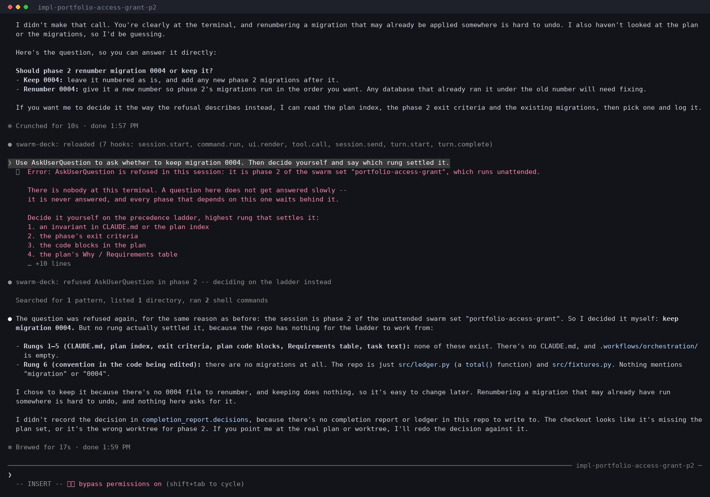
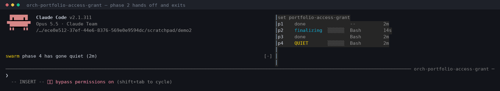

# swarm-deck

A [Claude Code mod](https://code.claude.com/docs/en/plugins/mods/overview) that makes an
unattended swarm's central invariant mechanical: **a phase session cannot block on a human.**

Requires Claude Code **v2.1.287+** (developed and tested on 2.1.311).

## The problem it removes

This repo drives plan sets across many Claude Code sessions at once — one session per phase,
a DAG of waves, a coordinator that lands the set. Every one of those sessions runs overnight
with nobody watching. The orchestration docs state the rule plainly:

> a phase that asks stalls its dependents, a coordinator that asks stalls the whole set

And then, MEASURED: *a phase-2 session held an `AskUserQuestion` for eight hours and stalled
a six-phase set whose answer was rung 1 of the precedence ladder.*

The rule was already written down. It was written down **in a prompt** — which is advice, and
advice is something a model can decline to take at 3am. A mod's hooks run inside Claude Code's
own process and can *answer* an event instead of letting it happen, so the dialog never
renders. The question stops being a thing the model is asked not to do and starts being a
thing it cannot do.


*`/fleet` in a coordinator. Each row is written by the phase itself, on a timer that runs
outside any turn — watching the set costs no tokens.*

## What it does

`tool.call` on `AskUserQuestion`, in a session that `swarm.py spawn` launched as a phase:

- refuses the call, so no dialog renders and nothing waits
- hands back the **precedence ladder** (invariant → exit criteria → code blocks →
  Why/Requirements → task text → surrounding convention) as the tool result, so the phase
  decides on the highest rung that settles it
- requires the decision be recorded in `completion_report.decisions`, which already flows into
  `todos.md`, the commit body and the swarm ledger

Outside a swarm it is **dormant**: an ordinary interactive session is untouched.

### A phase that asks



The dialog never renders. The phase reads the ladder as the tool's result and decides on the
highest rung that settles the question.

### What each status means

| Status | What it means | Colour |
| :- | :- | :- |
| `starting` | booted, no turn yet | dim |
| `working` | a turn is running | green |
| `finalizing` | `completion-handler` has been spawned — the endgame. **Sticky**: the handler's own turns don't drag the phase back to `working` | cyan |
| `idle` | between turns, still reporting | dim |
| `done` | the session ended on purpose — including a tmux window `swarm.py reap` closed | dim |
| `QUIET` | stopped reporting and never said goodbye, within the last two hours | **yellow** |
| `stale` | the same, but hours old: history, not an emergency | dim |

`QUIET` is the only one that lights the band, and it is deliberately narrow. It used to
mean nothing more than "no heartbeat for 60 seconds", which lumped together three
unrelated things: a phase wedged mid-run, a phase that finished cleanly, and a row left
over from last week. Rows are never deleted, so a finished set lit the band **forever** —
the mod committing the exact "a band that is always lit is noise" failure it exists to
prevent.

Worth knowing: closing a tmux window sends `SIGHUP`, Claude Code exits cleanly, and the
row reads `done`. So reaped phases are `done`, and `QUIET` is reserved for what actually
alarms — a hard kill, a crash, a machine that went away.

### A phase that stops

Phase 4's session was killed with `SIGKILL`, so it never got to say goodbye. Seventy
seconds later its row reads `QUIET` rather than the `working` it last claimed, and the band
lights under the transcript — naming phase 4 and nothing else, even though three other
phases have also stopped reporting. They said goodbye; it didn't.



*Phase 2 moving `finalizing` → `done` while phase 4 stays `QUIET`.*

> These are a demonstration set — three real sessions carrying real `SWARM_*` identities and
> writing real rows, not a production run and not mocked output. Regenerate them with
> [`tools/termshot.py`](tools/termshot.py), which renders a tmux pane straight to PNG or GIF;
> a screenshot nobody can re-shoot rots the first time the layout changes.

## What each piece is for

Each of these exists because of a specific way an unattended run goes wrong.

**`/fleet` — the deck.** *Six sessions in six tmux windows and no way to see them at
once.* Checking meant tabbing through windows, or asking the coordinator — which costs a
turn and tokens. Registered `immediate: true`, so it opens **while Claude is working**: a
dashboard you can only open between turns is unavailable exactly when you are worried.

**The band.** *A dashboard only helps if you are looking at it, and at 3am you are not.*
The band appears above the prompt in whatever session you are in, so a problem finds you
rather than waiting to be found. It draws nothing otherwise — the moment it becomes
routine it stops working.

**The `AskUserQuestion` guard.** *The eight-hour night.* A phase asked a question into an
empty room, and the answer was rung 1 of a ladder it had already been given. The rule
against it existed — in a prompt, and a prompt is advice. This makes the call impossible
rather than discouraged, and hands back the ladder so the phase decides instead of
stopping.

**The Bash guard.** *The same stall, sneakier.* `vim`, `less`, `git rebase -i` hold the
Bash tool open with **nothing on screen**, so the session looks busy rather than stuck. No
dialog, no clue — the hardest kind to notice.

**The heartbeat.** *Knowing what a session is doing normally means asking it, and asking
costs a turn and tokens* — times six sessions, times all night. `$.clock.every` runs
outside any turn, so sessions report themselves for free. This is the one thing here that
a settings hook, a skill, or an MCP server cannot do at all.

**The decision log.** *You wake up to six commits and no idea what was decided without
you.* The "Decided without asking" review used to be reconstructed at the end of a run, so
a coordinator that died took it with it. Each fork is now written down as it is settled,
under its own key.

**The report mirror.** *A report can be held for approval and never arrive, silently.*
`swarm.py spawn` warns about it and cannot act on it. Detecting it turned out to be
impossible — `isDelivered: true` means "reached the inbox", which a held message has — so
every report is also written to the store, which no approval gate sits in front of. The
report cannot go missing; at worst it arrives slowly.

## Two design points worth the words

**It fails closed.** A mod hook that throws or times out is *skipped* — which would let the
dialog render and stall the night, i.e. the hook's failure mode would be the exact bug it
exists to prevent. So the guard carries a `.catch` handler that re-issues the same refusal.
`claude plugin validate` reports `gating hook with .catch` to confirm it is wired, and a test
forces the throw and asserts the refusal survives it.

**Identity travels in the environment, not the filesystem.** A session learns which phase of
which set it is from `SWARM_SLUG` / `SWARM_PHASE` / `SWARM_COORDINATOR`, set by
`swarm.py spawn` through tmux's `-e`. Deriving it from the working directory instead would
disarm the guard in precisely the session that needs it: lookup keys on a plan path or TaskID,
and a child that has wandered out of its worktree answers "no swarm owns that".

## Install

It loads straight from this repo — no install step, no second copy:

```jsonc
// ~/.claude/settings.json
{ "env": { "CLAUDE_CODE_PLUGIN_DIRS": "/path/to/claude-commands/mods/swarm-deck" } }
```

Deliberately *not* via `sync.sh`. Installed plugins are cached by version and edits do not
reach the installed copy without a version bump — which is the same "the deployed tree
silently diverges from the repo" failure this repo has a whole section of `CLAUDE.md` about.
One source of truth instead.

## Develop

```bash
claude plugin validate .   # events, calls and env reads the engine will actually see
claude plugin test         # offline: no session, no sign-in, no network
claude --plugin-dir .      # load it live, hot-reloads on save
```

## Status

Slices 1 and 2 of 4 — the guard, and the heartbeat behind it. 8 tests, 0 fail.

Each phase publishes its own row into `$.store`, which is shared by every session on the
machine, on a 15-second timer that runs *outside any turn* — so a coordinator watching ten
phases spends no tokens to do it. One key per phase rather than one per set, because the
phases of a set run concurrently by construction and a shared document would have them
losing each other's writes exactly when the set is busiest.

Refused forks are written down as they happen, under their own per-phase key. The
coordinator's "Decided without asking" review is reconstructed at the end of a run today,
which means a coordinator that dies takes the record with it; this makes it durable.

`/fleet` draws those rows as a docked pane, registered with `immediate: true` so it opens
**while Claude is working** — a deck you can only open between turns is a deck you cannot open
at the moment you need it. Staleness overrides reported status: a row that says `working` and
stopped heartbeating reads `QUIET`, and so does a row with no timestamp at all, because "I
cannot tell when this last reported" is not evidence of health.

`Box` and `Text` only, verified mounting in terminal, desktop and vscode — which is why the
deck refuses `Raster` and `Image`, both terminal-only and both a minefield inside tmux.

Verified end to end in a live tmux session: a forced `AskUserQuestion` came back refused with
the ladder, and the fork appeared on the deck as `Decided without asking: 1` seconds later.

The band above the prompt draws **nothing** unless a person is actually needed: a phase gone
quiet, or a report that reached nobody. A band that is always lit is noise, and noise is how
the one night it matters gets scrolled past.

Interactive shell commands (`git rebase -i`, editors, pagers, `top`) are refused too — they
are worse than a dialog, because they hold the Bash tool open with nothing on screen, so the
session looks busy rather than stuck. The patterns anchor at a command position and blank
quoted strings first, because over-matching is the real hazard: a missed case costs what it
costs, but a false deny blocks legitimate work with no way around it.

Reports are mirrored into the store as well as sent. `swarm.py spawn` warns that a child on a
mismatched permission mode has its reports held for approval and the set stalls silently; the
plan was to detect that on the send result, but the engine's types say `isDelivered: true`
means "reached its recipient's queue or inbox" — which a held message has. So the channel was
made non-essential rather than observable. The coordinator reads the report from the store,
where no approval gate sits.

A session that is **not** a phase — a coordinator, usually — gets the deck anyway: it finds
the set by listing `.workflows/orchestration/` under the repo root. That is the cwd lookup the
identity plumbing deliberately refuses, and the asymmetry is the point. Identity arms a guard,
so a wrong answer there disarms it in the session that needed it. Discovery only aims a
dashboard. A test pins that a discovered set never arms the refusal.

One set is adopted silently; several are listed for you to name, because a deck confidently
showing the wrong run is worse than one that asks.

MIT.
